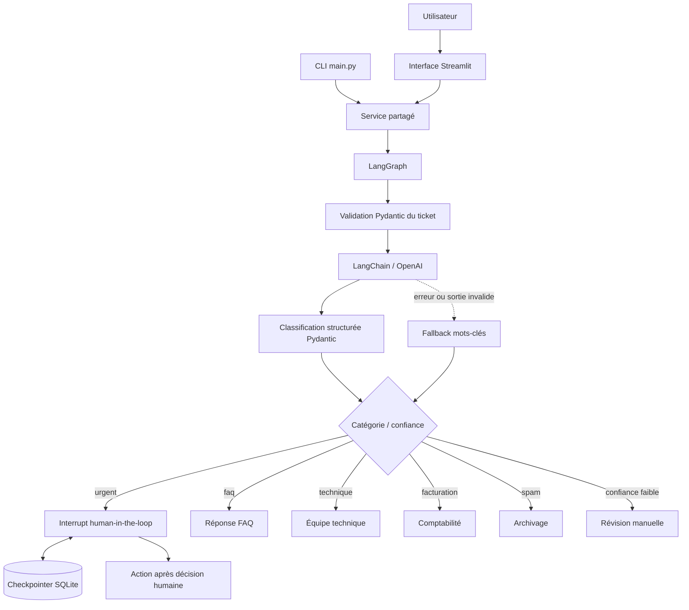

# Support Ticket Triage

Workflow LangGraph qui classe les tickets avec LangChain et OpenAI, valide la
sortie avec Pydantic, puis route les demandes vers FAQ, technique, facturation,
urgent, spam ou révision manuelle. Si le LLM échoue, les règles locales
constituent un mécanisme de fallback.

## Architecture



Le checkpointer SQLite permet de reprendre un ticket urgent suspendu après un
redémarrage de l'interface. Les actions de réponse, transmission et archivage
restent simulées; elles ne contactent pas encore de systèmes externes.

## Installation

```powershell
python -m venv .venv
.venv\Scripts\Activate.ps1
pip install -r requirements.txt
Copy-Item .env.example .env
```

Renseignez `OPENAI_API_KEY` dans `.env` pour activer la classification OpenAI.
Sans cette clé, ou en cas d'erreur du LLM, le classificateur local est utilisé.
Ne partagez pas le fichier `.env`.

## Lancement

```powershell
python main.py
streamlit run streamlit_app.py
pytest
```

Dans le CLI comme dans Streamlit, les urgences sont suspendues jusqu'à une
décision humaine. Le CLI demande cette décision dans le terminal; Streamlit
propose des boutons de confirmation ou de rejet.

## Configuration

| Variable | Rôle | Défaut |
|---|---|---|
| `OPENAI_API_KEY` | Clé d'accès OpenAI | Aucune (fallback local) |
| `OPENAI_MODEL` | Modèle OpenAI | `gpt-4o-mini` |
| `TICKET_CONFIDENCE_THRESHOLD` | Seuil de routage automatique | `0.65` |
| `TRIAGE_CHECKPOINT_DB` | Emplacement du checkpoint SQLite | `data/triage_checkpoints.sqlite` |

Une confiance inférieure au seuil route vers la révision manuelle au lieu de
traiter le ticket comme FAQ. La confiance renvoyée par le modèle reste une
estimation; elle doit être évaluée et calibrée sur des tickets représentatifs
avant d'automatiser des actions métier sensibles.

## Structure

```text
main.py                    CLI
streamlit_app.py           Interface utilisateur
src/triage/config.py       Configuration et variables d'environnement
src/triage/schemas.py      Modèles Pydantic d'entrée et de classification
src/triage/llm.py          Client de classification LangChain / OpenAI
src/triage/state.py        État du graphe LangGraph
src/triage/nodes.py        Classification, fallback et nœuds métier
src/triage/graph.py        Assemblage et routage conditionnel
src/triage/service.py      Service partagé et checkpoint SQLite
data/sample_tickets.json  Tickets de démonstration
tests/                     Tests unitaires sans appel réseau
```

## Sécurité et limites

- Les tests remplacent le client LLM et ne nécessitent ni clé ni accès réseau.
- Le logger n'enregistre pas le corps du ticket ni les secrets.
- Les données de ticket et les décisions du workflow sont stockées dans le
  checkpoint local SQLite; protégez ce fichier selon vos exigences de données.
- Le fallback par mots-clés est volontairement simple et doit être adapté à
  vos règles métier avant une utilisation en production.
